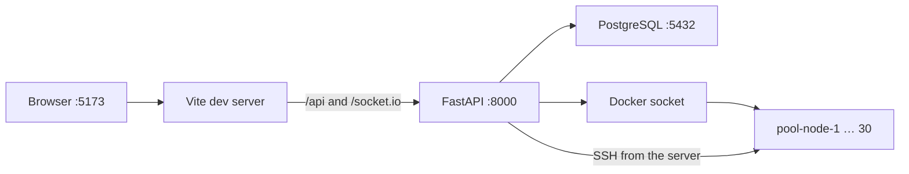
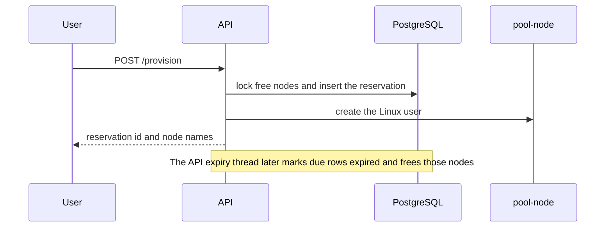

# ODP

Local app for reserving Ubuntu SSH containers on one Linux machine. The browser is Vue 3. The API is FastAPI. Data is in PostgreSQL. Docker runs the pool beside the API.

Open [http://127.0.0.1:5173](http://127.0.0.1:5173) after the two processes below are up. Sign in with `admin` / `admin` on the first login. That account is created then. Register makes a normal user. An admin cannot reserve a machine.

## Contents

- [How a request moves](#how-a-request-moves)
- [What you need](#what-you-need)
- [Database](#database)
- [Run](#run)
- [Container pool](#container-pool)
- [Pages](#pages)
- [HTTP API](#http-api)
- [Terminal](#terminal)
- [Reservations](#reservations)
- [Configuration](#configuration)
- [Layout](#layout)
- [Checks](#checks)
- [Left in the tree](#left-in-the-tree)

## How a request moves



The page and the API share one origin in development. Vite forwards `/api` to port 8000 and strips that prefix, so the browser calls `/api/login` and FastAPI receives `/login`. Vite also forwards `/socket.io`, including WebSocket. Cookie `session` is HttpOnly, SameSite=Lax, and lasts 14 days. It is sent on `http://127.0.0.1`.

The API process starts one expiry thread. That thread is the only thing that should release an expired container. Do not run a second API process against the same Docker daemon.

## What you need

- Python 3.12 or newer
- Node.js 22
- Docker, with permission to use the Docker socket
- Ansible on the host, only when a reservation installs packages

Commands below start from the repository root, except the frontend commands, which start in `frontend/`.

## Database

```bash
docker compose up -d --wait
python3 -m venv api/.venv
api/.venv/bin/pip install -r api/requirements.txt
cp -n api/.env.example api/.env
api/.venv/bin/python -m api.migrate
```

`docker compose up -d --wait` returns when PostgreSQL answers `pg_isready`. Compose only starts the database. It does not run SQL.

`cp -n` does not replace an `api/.env` that is already there. `api/.env` is local and is not committed. The example uses database `odp_platform`, user `odp`, password `odp`, on `localhost:5432`.

`api.migrate` applies each new file in `database/postgres/` once and stores a SHA-256 checksum in `schema_migrations`. The first file is `001_init.sql`. It creates `users`, `reservations`, and `pool_nodes`. It does not drop an existing database. A file that was already applied must not be edited. Add `002_something.sql` instead. Running migrate again prints that nothing is pending.

The root `requirements.txt` points at `api/requirements.txt`. Install with the API virtualenv, as above.

## Run

API, from the repository root:

```bash
api/.venv/bin/uvicorn api.main:app --host 127.0.0.1 --port 8000
```

Frontend:

```bash
cd frontend
npm install
npm run dev -- --host 127.0.0.1 --port 5173
```

Reload the API process after a Python change. This command does not pass `--reload`. Vite reloads the page after a Vue change.

`GET /health` on port 8000 returns `{"status":"ok"}` without PostgreSQL. `GET /pool/status` returns 503 `Database unavailable` when PostgreSQL is down. The error body is `{"status":"error","message":"..."}`. Success bodies use `"status":"success"`. Exception text is not sent to the browser.

## Container pool

`init_pool.py` builds `pool-node:latest` from `Docker/ssh/dockerfile`, starts `pool-node-1` through `pool-node-30`, and stores them as free rows.

```bash
api/.venv/bin/python init_pool.py
```

Docker must already be running, and `api.migrate` must already have created `pool_nodes`. Run this from the repository root so the API package imports. Do not run it while a reservation is active. The script removes each existing `pool-node-N` and resets that row to `free`.

| Piece | Value |
| --- | --- |
| Image | `pool-node:latest`, Ubuntu 22.04, `sshd` in the foreground |
| Names | `pool-node-1` … `pool-node-30` |
| Host ports | `3000` … `3029` mapped to container port `22` |
| Network | `pool-network`. Created with subnet `172.30.0.0/24` when missing. Reused when it already exists |
| Restart | `unless-stopped` |
| Row | `status=free`, `owner` empty, `expiry=0` |

The published SSH ports listen on all host interfaces. That is Docker’s default publish.

<details>
<summary>What the script does when a node fails</summary>

1. If the old container cannot be removed, the script leaves that pool row in place and moves on. The old container is still the one running.
2. If the new container starts but Docker assigns no address, or PostgreSQL rejects the save, the script removes the new container and deletes that pool row.
3. The line `Pool initialized with 30 free nodes.` is printed only when all 30 nodes were stored. Any failure exits with status 1.

</details>

The image user inside the container is `vagrant`. A reservation adds the account’s own Linux user and does not send that user’s password to the browser.

Recover, on the admin pool page, only runs `docker start` for stopped containers whose names start with `pool-node-`. It does not create a missing container and it does not change PostgreSQL.

## Pages

| URL | Who | What it does |
| --- | --- | --- |
| `/` | anyone | Home |
| `/about` | anyone | Short description of the stack |
| `/login`, `/register` | signed out | Register does not sign you in. It sends you to `/login` |
| `/home` | signed in | Pool counts and your reservations. An admin sees a notice instead of the reserve form |
| `/provision` | signed in | Ask for machines. After success the page stays here and shows the new id and nodes |
| `/reservations/:id` | signed in | Detail for your own reservation. Anyone else, or an unknown id, sees “Reservation not found” |
| `/terminal/:nodeName` | signed in | SSH in the page. No site header. The machine password is not on this page |
| `/admin` | signed in | Counts. A normal user who opens the URL gets “Admin access required” from the API |
| `/admin/users` | signed in | List, add a user, promote a normal user to admin, delete a normal user |
| `/admin/reservations` | signed in | Every reservation. Delete sets status `deleted` and keeps the row |
| `/admin/pool` | signed in | Nodes, plus Recover |

The router asks `GET /session` once per page load. A 401 clears the browser session. A network error or 503 leaves it, and the next navigation tries again. The Admin link is shown only when the restored role is `admin`.

## HTTP API

The browser prefixes these paths with `/api`. Calling uvicorn directly uses the paths as written.

Cookie rules:

- No cookie on a route that requires one: 401 `Authentication required`.
- Admin routes read the role from `users`, not from the cookie alone. A normal user gets 403 `Admin access required`.
- `/provision` also rejects an admin cookie before it looks at the database, and rejects an admin row in `users` as well.

<details>
<summary>Routes</summary>

| Method | Path | Session | Effect |
| --- | --- | --- | --- |
| `GET` | `/health` | no | Liveness. Does not touch the database |
| `GET` | `/pool/status` | no | `total`, `free`, `allocated` |
| `GET` | `/pool/nodes` | no | Every pool row |
| `GET` | `/users/{username}/reservations` | no | That user’s reservations. No machine password |
| `GET` | `/reservations/{id}` | no | One reservation, or 404. No machine password |
| `POST` | `/register` | no | Creates a `user`. Username `admin` is reserved |
| `POST` | `/login` | creates it | Checks the password, then stores `username` and `role` |
| `GET` | `/session` | yes | Returns the account and refreshes `role` from the database |
| `POST` | `/logout` | clears it | Closes that user’s open terminals, then returns success |
| `POST` | `/provision` | user | Reserves machines. Body below |
| `POST` | `/reservations/{id}/release` | owner | Returns that reservation’s containers |
| `GET` | `/admin/overview` | admin | User counts, active reservations, pool totals |
| `GET` | `/admin/users` | admin | Users, with reservation counts. No password hash |
| `POST` | `/admin/users` | admin | Same as register. A `role` field in the body is ignored |
| `PUT` | `/admin/users/{username}/role` | admin | Only `user` or `admin`. Cannot change username `admin`. Cannot demote an admin |
| `DELETE` | `/admin/users/{username}` | admin | Cannot delete `admin` or any other admin. Frees nodes of active reservations, then deletes the account |
| `GET` | `/admin/reservations` | admin | All reservations, newest first. No machine password |
| `DELETE` | `/admin/reservations/{id}` | admin | Deletes the Linux user on those nodes, frees them, sets status `deleted` |
| `GET` | `/admin/pool` | admin | Same node fields as `/pool/nodes` |
| `POST` | `/admin/pool/recover` | admin | Starts stopped `pool-node-*` containers. Returns how many were started |

`POST /provision` body:

```json
{ "vm_count": 1, "duration": 60, "password": "machine-password", "packages": "" }
```

`vm_count` and `duration` are minutes-and-count integers from 1 to 2147483647. `duration` defaults to 60. `password` is the Linux password for the new account inside the containers. It cannot be empty, cannot contain a newline or a NUL, and cannot be longer than 127 bytes. `packages` is an optional comma-separated list of apt package names.

When the pool does not have enough free nodes the response is 409 and includes how many were free. The machine password is encrypted before it is stored. The reservation response does not contain it.

</details>

## Terminal

The page at `/terminal/:nodeName` speaks Socket.IO. The server reads the session cookie, checks that the user still exists, and joins a room named with that username. A password sent by the browser on `connect_ssh` is ignored. The server decrypts the stored machine password and opens SSH itself.

| Event | Direction | Meaning |
| --- | --- | --- |
| `connect` | browser → server | Rejected without a live account |
| `request_reservation_info` | browser → server | The node must belong to an active reservation that has not expired |
| `connect_ssh` | browser → server | Opens the shell. Send `cols` and `rows` with it |
| `input` | browser → server | Keystrokes for that socket’s shell |
| `resize` | browser → server | `cols` and `rows`, each from 1 to 1000 |
| `output` | server → browser | Bytes from that shell only |
| `force_disconnect` | server → browser | `Reservation expired`, or `Signed out` after logout |
| `disconnect` | either | Closes the SSH client for that socket |

One socket holds at most one shell. Logout closes every open terminal for that user and sends `Signed out` once.

## Reservations



A normal user can release their own active reservation from the detail page. The API removes the Linux user from those containers and sets the row to `released`.

The expiry thread in the API process marks a due `active` reservation `expired`, removes the Linux user, and returns the nodes to `free`. Opening a terminal past `expires_at` sends `Reservation expired` and closes SSH. It does not type a warning into the remote shell.

If `packages` is non-empty, Ansible runs on the host after the reservation is stored, with a private inventory file that is removed when the job ends. The HTTP response is already success by then. A failure to start that background job does not change the response. The playbook is `Ansible/playbook.yml`.

Account passwords are stored as SHA-256 hex digests. Machine passwords are stored with Fernet. Neither is returned by the JSON routes above.

## Configuration

`api/settings.py` reads `api/.env`. Values in that file replace variables already set in the shell.

| Variable | Example | Used for |
| --- | --- | --- |
| `POSTGRES_HOST` | `localhost` | Database host |
| `POSTGRES_PORT` | `5432` | Database port |
| `POSTGRES_USER` | `odp` | Database user |
| `POSTGRES_PASSWORD` | `odp` | Database password |
| `POSTGRES_DB` | `odp_platform` | Database name |
| `SESSION_SECRET` | `odp-local-session` | Signs the session cookie |
| `FERNET_SECRET` | see `api/.env.example` | Fallback material for the machine-password key |
| `ENCRYPTION_KEY` | empty in the example | Fernet key material when set |

PostgreSQL in Compose uses the same database name, user, and password. The data volume is `odp-pgdata`.

## Layout

| Path | Responsibility |
| --- | --- |
| `api/main.py` | HTTP routes and the session cookie. Starts the expiry thread |
| `api/settings.py` | Reads `api/.env` |
| `api/db.py` | PostgreSQL connections. No SQL for a feature lives here |
| `api/migrate.py` | Applies numbered SQL files and checks checksums |
| `api/user_sql.py` | Users, roles, the default admin |
| `api/reservation_sql.py` | Reservation rows. Public reads omit the machine password |
| `api/pool_sql.py` | Pool counts, node rows, `save_free_node`, `delete_pool_node` |
| `api/provisioning.py` | Reserve machines. Calls SQL, Docker, then Ansible |
| `api/releasing.py` | Release, admin delete of a reservation, admin delete of a user |
| `api/expiry.py` | One thread that expires due reservations |
| `api/containers.py` | Docker: configure a node, restart stopped pool containers |
| `api/ansible_jobs.py` | Background package install |
| `api/auth.py` | Login check and the admin gate |
| `api/terminal_socket.py` | Socket.IO events. No SQL |
| `api/ssh_terminal.py` | Paramiko session for one socket |
| `api/terminal_access.py` | Whether this user may open this node |
| `frontend/src/views/` | One screen per file |
| `frontend/src/api/` | Typed HTTP clients. `http.ts` does not redirect on 401 |
| `frontend/src/stores/session.ts` | The signed-in account held in memory |
| `frontend/src/router/index.ts` | Routes and `meta.requiresAuth` |
| `database/postgres/` | The only schema source |
| `Docker/ssh/` | Image for a pool node |
| `init_pool.py` | Builds that image and writes free rows. No SQL of its own |
| `docker-compose.yml` | PostgreSQL 16 only |

## Checks

From the repository root:

```bash
api/.venv/bin/python -m pytest
```

From `frontend/`:

```bash
npx vue-tsc --noEmit
```

`npm run build` runs that type check and then `vite build`.

## Left in the tree

`vagrant/` is not used by the running app. `Docker/` is used: `init_pool.py` builds from `Docker/ssh`.

`pool_manager.sh` and `database/migrate_data.py` still speak MySQL. They are not how this app starts, and they are not where the pool is stored.
